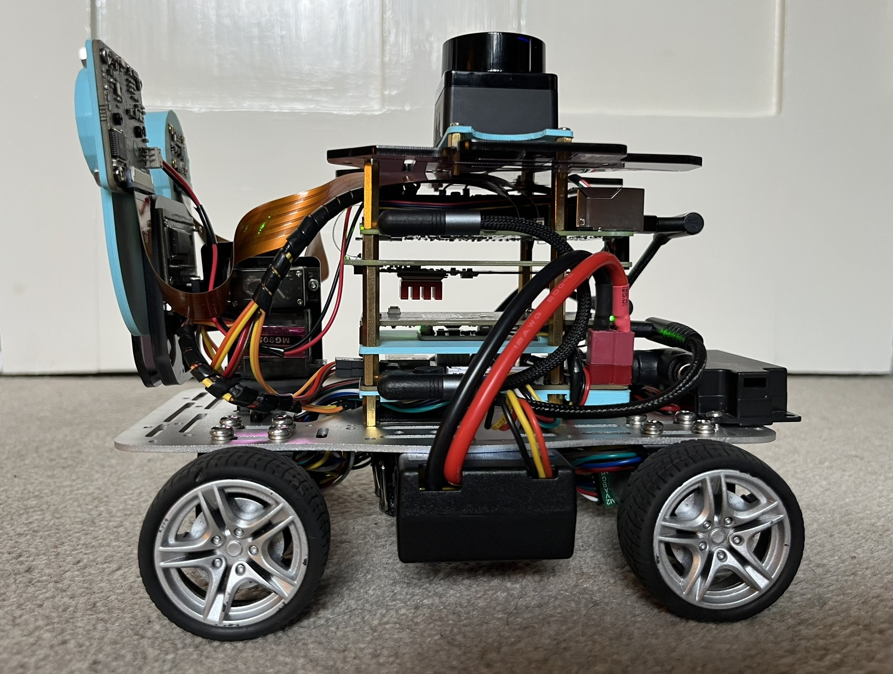

# Robot_Pi_4WD_ROS





## Installation
1. Download and install a new pi bookworm image in a micro sd. Proposed a Sundisk Extreme A2 256GB using the pi imager 
2. Edit the imager settings and add your ~/.ssh/id_rsa.pub
3. Connect to your raspberry pi5 into the a monitor through hdmi0 a keyboard and mouse
4. Connect to your pi5 through ssh from you desktop if you skipped adding your ssh pub keys in step 1. write your `~/.ssh/id_rsa.pub` in a usb stick and copy the contents in the pi ~/.ssh/authorized-keys
5. `sudo update && sudo full-upgrade && sudo install -y vim less`
6. Install docker: https://docs.docker.com/engine/install/debian/#install-using-the-repository and https://docs.docker.com/engine/install/linux-postinstall/
7. Add these in `/boot/firmware/config.txt`:
```
camera_auto_detect=0
[all]
dtparam=pciex1_gen=3
power_force_3v3_pwm=1
dtoverlay=arducam-pivariety,cam0
dtoverlay=imx708,cam1
```
   `cam0` is the Arducam ToF, `cam1` the Camera Module 3 (use `imx296` for the Global Shutter camera).
8. Run `sudo raspi-config` and enable: i2c, vnc, ssh, pcie3
9. Add an alias to the microros serial port according to https://forums.raspberrypi.com/viewtopic.php?t=90265:
    `echo 'ACTION=="add",ENV{ID_SERIAL}=="Silicon_Labs_CP2102_USB_to_UART_Bridge_Controller_0001",ENV{ID_SERIAL_SHORT}=="0001",SYMLINK+="ttyUSB_ROS\"' >> /etc/udev/rules.d/99-usbserial.rules`
10. Download the source code: `git clone https://github.com/kyrikakis/Robot_Pi_4WD_ROS.git`
11. Run the image: `cd Robot_Pi_4WD_ROS && docker compose up`.
    The code is built into the image, so to update later: `git pull && docker compose build && docker compose up -d`
12. Optional: Install realtek drivers
    ```
    apt-get install raspberrypi-kernel-headers
    git clone -b v5.6.4.2 https://github.com/aircrack-ng/rtl8812au.git
    sudo git checkout 63cf0b4
    make
    make install
    ```

## Software

Rainbow's ROS 2 packages live in `src/`:

| Package | What it does |
|---|---|
| `rainbow_description` | URDF of the robot: chassis, sensors and the pan/tilt head |
| `rainbow_bringup` | Launch files and all configuration (EKF, BNO055, SLAM, Nav2) |
| `rainbow_drivers` | Head, eyes, ToF depth camera, velocity watchdog, IP publisher |
| `rainbow_voice` | Text to speech; wake word placeholder (`voice.launch.py wake_word:=true`) |
| `rainbow_interfaces` | Service definitions |

The ESP32 board runs the motors (with PID), the head servos, the lidar, battery
monitoring and its own IMU. It talks to the Pi over micro-ROS (`/dev/ttyUSB_ROS`).
The ESP's IMU is mounted the wrong way round and is not used; the EKF uses the
BNO055 on the Pi.

Face recognition runs on the Hailo in its own container, from
[hailo_tappas_ros2](https://github.com/kyrikakis/hailo_tappas_ros2).

### Services

Supervisor starts these when the container starts (`supervisor/rainbow.conf`):

| Program | Launch file | Contents |
|---|---|---|
| `rainbow_base` | `base.launch.py` | micro-ROS agent, description, BNO055, EKF, head, eyes, ToF, velocity watchdog, IP publisher |
| `rainbow_slam` | `slam.launch.py` | slam_toolbox |
| `rainbow_navigation` | `navigation.launch.py` | Nav2 |
| `rainbow_foxglove` | `foxglove.launch.py` | Foxglove bridge on port 8765 |
| `rainbow_voice` | `voice.launch.py` | Text to speech |

```
supervisorctl status
supervisorctl restart rainbow_navigation
supervisorctl tail -f rainbow_base
```

To run everything by hand instead: `scripts/rainbow_launch.sh rainbow.launch.py`
(arguments `slam`, `navigation`, `foxglove`, `voice`, `tof`, `microros`, all
default `true`).

### Talking to the robot

```
# Head (radians; pan positive = left, tilt positive = down)
ros2 service call /head/set_pose rainbow_interfaces/srv/SetHeadPose "{pan: 0.3, tilt: 0.0}"
ros2 service call /head/center std_srvs/srv/Trigger

# Eyes: happy, open, closed, off
ros2 service call /eyes/set_expression rainbow_interfaces/srv/SetExpression "{expression: happy}"

# Speech
ros2 service call /speech/say rainbow_interfaces/srv/Say "{text: 'Hello, I am Rainbow'}"
```

The old topics still work: `/head/z_rotation` and `/head/y_rotation` (degrees),
`/eyes`, `/speech/speak` and `/speech/amplitude`.

Driving: Nav2 and teleop publish to `/cmd_vel_stamped`; the velocity watchdog
forwards that to the ESP on `/cmd_vel` and sends zero velocity when commands stop.

```
ros2 run teleop_twist_keyboard teleop_twist_keyboard --ros-args -r cmd_vel:=cmd_vel_stamped
```

### Foxglove

Connect the Foxglove app to `ws://<robot-ip>:8765` (Foxglove WebSocket; the IP is
published on `/rpi5_ip`), then import the layout `foxglove/rainbow.json`. It has the
3D view (click to send a Nav2 goal), teleop, commanded vs actual speed, head and
eyes controls, the face-recognition camera and the log. The ToF cloud is heavy
over Wi-Fi; hide `/point_cloud` in the 3D view if it lags.

### Useful commands

```
ros2 run tf2_tools view_frames
ros2 run rqt_graph rqt_graph
```
