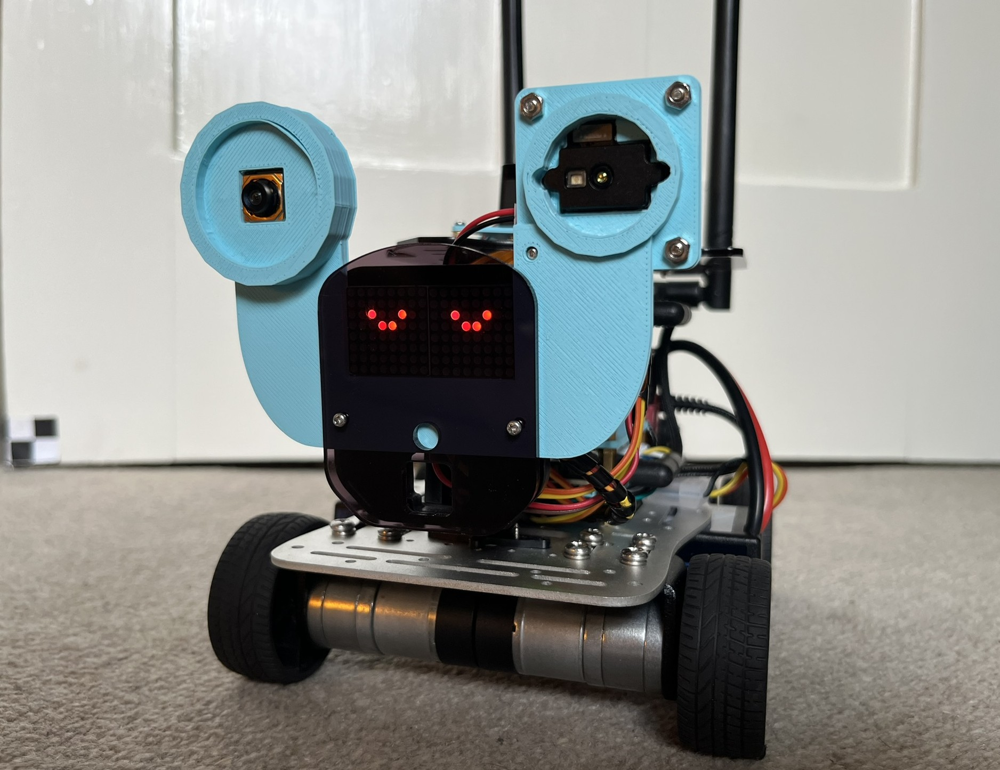
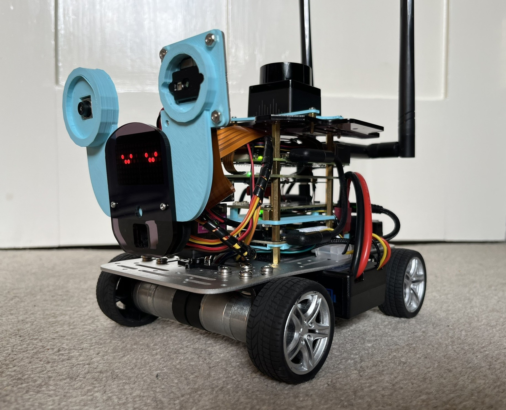
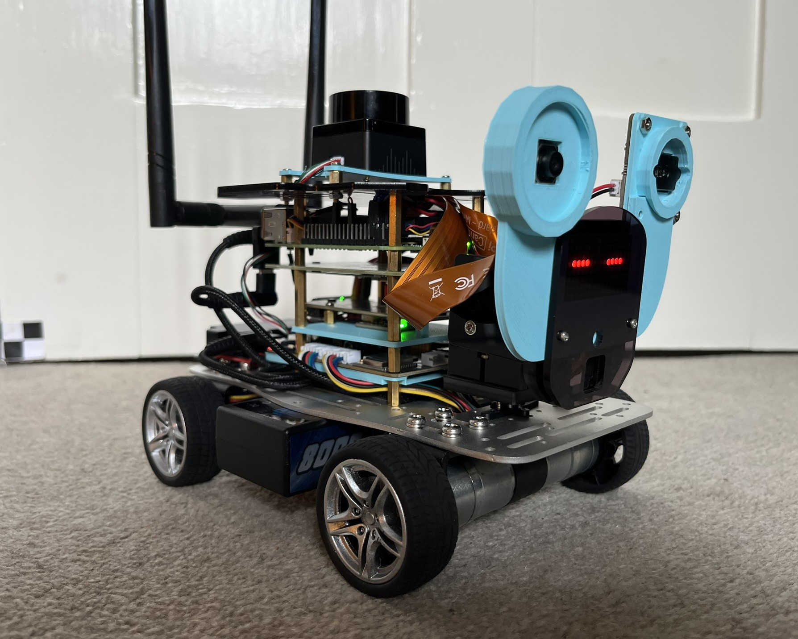
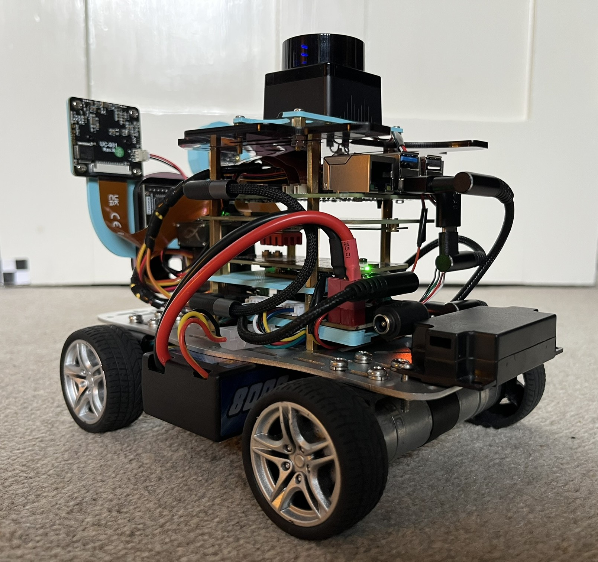
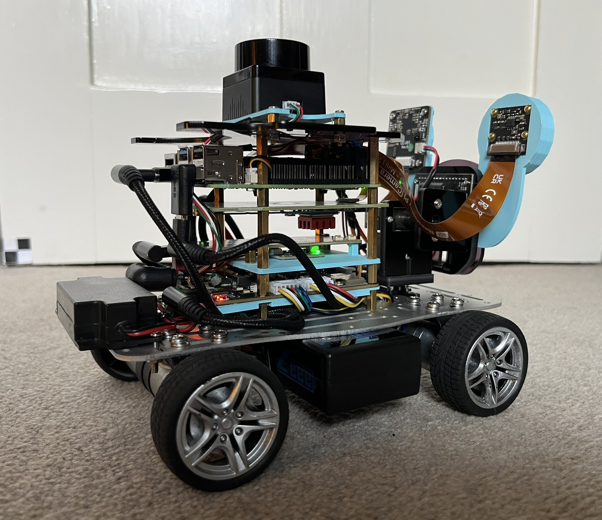
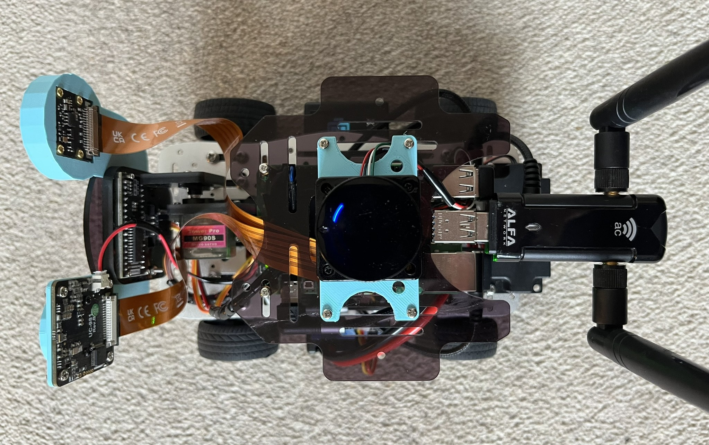

# Robot_Pi_4WD_ROS









## Hardware

| Part | What | Connected to |
|---|---|---|
| Computer | Raspberry Pi 5 | |
| AI accelerator | Hailo-8 (face recognition and object detection, in its own container) | PCIe |
| Motor controller | Yahboom MicroROS control board (ESP32) | USB serial (CP2102), micro-ROS |
| Motors | 4x Yahboom MD310Z20: 7.4 V, 1:20, encoder, 3 mm D-shaft, 450 rpm | ESP32 board |
| Wheels | 65 mm, skid-steer (wheelbase 13 cm, 14 cm across) | Motors |
| Lidar | Oradar MS200 | ESP32 board |
| Head | Pan/tilt, 2x MG90S servos | ESP32 board |
| Depth camera | Arducam ToF, in the head | CSI (`cam0`) |
| RGB camera | Raspberry Pi Camera Module 3, in the head | CSI (`cam1`) |
| IMU | BNO055 (the ESP32 board's own IMU is unused) | I2C |
| Eyes | Two 8x8 LED matrices on an HT16K33 | I2C |
| Microphone and speaker | ReSpeaker Lite, speaker on its output | USB |
| Wi-Fi | ALFA adapter (rtl8812au driver) | USB |
| Battery | Zee 2S LiPo 7.4 V, 8000 mAh, 100C (~6.9-8.0 V in use) | ESP32 board |

## Installation
1. Download and install a new pi bookworm image in a micro sd. Proposed a Sundisk Extreme A2 256GB using the pi imager 
2. Edit the imager settings and add your ~/.ssh/id_rsa.pub
3. Connect to your raspberry pi5 into the a monitor through hdmi0 a keyboard and mouse
4. Connect to your pi5 through ssh from you desktop. If you skipped adding your ssh pub key in step 2, write your `~/.ssh/id_rsa.pub` to a usb stick and copy its contents into the pi's `~/.ssh/authorized_keys`
5. `sudo apt update && sudo apt full-upgrade -y && sudo apt install -y vim less`
6. Install docker: https://docs.docker.com/engine/install/debian/#install-using-the-repository and https://docs.docker.com/engine/install/linux-postinstall/
7. Add these in `/boot/firmware/config.txt`:
```
camera_auto_detect=0
[all]
dtparam=pciex1_gen=3
power_force_3v3_pwm=1
dtoverlay=arducam-pivariety,cam0
dtoverlay=imx708,cam1
```
   `cam0` is the Arducam ToF, `cam1` the Camera Module 3 (use `imx296` for the Global Shutter camera).
8. Run `sudo raspi-config` and enable: i2c, vnc, ssh, pcie3
9. Add an alias to the microros serial port according to https://forums.raspberrypi.com/viewtopic.php?t=90265:
    `echo 'ACTION=="add",ENV{ID_SERIAL}=="Silicon_Labs_CP2102_USB_to_UART_Bridge_Controller_0001",ENV{ID_SERIAL_SHORT}=="0001",SYMLINK+="ttyUSB_ROS\"' >> /etc/udev/rules.d/99-usbserial.rules`
10. Download the source code: `git clone https://github.com/kyrikakis/Robot_Pi_4WD_ROS.git`
11. Run the image: `cd Robot_Pi_4WD_ROS && docker compose up`.
    The code is built into the image, so to update later: `git pull && docker compose build && docker compose up -d`.
    Switching to the new image restarts the micro-ROS agent, and the ESP's USB serial chip may lock up a few minutes later: see "ESP connection" in [AGENTS.md](AGENTS.md).
12. Optional: Install realtek drivers
    ```
    sudo apt-get install raspberrypi-kernel-headers
    git clone -b v5.6.4.2 https://github.com/aircrack-ng/rtl8812au.git
    cd rtl8812au && git checkout 63cf0b4
    make
    sudo make install
    ```

## Software

Rainbow's ROS 2 packages live in `src/`:

| Package | What it does |
|---|---|
| `rainbow_description` | URDF of the robot: chassis, sensors and the pan/tilt head |
| `rainbow_bringup` | Launch files and all configuration (EKF, BNO055, SLAM, Nav2) |
| `rainbow_drivers` | Head, eyes, ToF depth camera, velocity watchdog, lidar power, IP publisher, Nav2 plan for Foxglove (`/plan_viz`) |
| `rainbow_voice` | Text to speech; the ears: wake word, utterances, local commands on the ReSpeaker Lite |
| `rainbow_brain` | Local brain ([design](docs/brain.md)): skills (go to a place, turn, drive, stop), named places on the map, memory, photos and faces, greeting people, head tracking, pick-up and low-battery modes, the link to the Mac agent |
| `rainbow_web` | Phone remote: a web page served from the robot (camera, map, places, joysticks) |
| `rainbow_interfaces` | Service, action and message definitions |
| `rainbow_esp_msgs` | Messages of the ESP firmware's own topics (also built into micro-ROS) |

The ESP32 board runs the motors (with PID), the head servos, the lidar, battery
monitoring and its own IMU. It talks to the Pi over micro-ROS (`/dev/ttyUSB_ROS`).
Its firmware is ours, in [`firmware/`](firmware/README.md) (build, flash, back up, restore).
The ESP's IMU is mounted the wrong way round and is not used; the EKF uses the
BNO055 on the Pi.

Face recognition and object detection run on the Hailo in its own container, from
[hailo_tappas_ros2](https://github.com/kyrikakis/hailo_tappas_ros2).

The robot's agent runs on a Mac, in [`agent/`](agent/README.md): speech to text,
a language model with the robot's skills as tools, and memory. It talks to the
brain over a WebSocket on port 8766; `rainbow-agent pair` fetches the link token
from the robot once.

### Services

Supervisor starts these when the container starts (`supervisor/rainbow.conf`):

| Program | Launch file | Contents |
|---|---|---|
| `rainbow_microros` | `microros.launch.py` | micro-ROS agent (ESP board), lidar power (on only while needed) |
| `rainbow_base` | `base.launch.py` | description, BNO055, EKF, eyes, velocity watchdog, IP publisher |
| `rainbow_tof` | `tof.launch.py` | ToF camera |
| `rainbow_head` | `head.launch.py` | Pan/tilt head (smooth moves) |
| `rainbow_localization` | `localization.launch.py` | map_server + AMCL on the saved map in `maps/` |
| `rainbow_slam` | `slam.launch.py` | slam_toolbox, for mapping (not started by default) |
| `rainbow_navigation` | `navigation.launch.py` | Nav2 |
| `rainbow_foxglove` | `foxglove.launch.py` | Foxglove bridge on port 8765 (not started by default) |
| `rainbow_voice` | `voice.launch.py` | Text to speech, wake word and listening (ReSpeaker Lite) |
| `rainbow_brain` | `brain.launch.py` | Local brain, places, link to the Mac agent (port 8766), head tracker |
| `rainbow_web` | `web.launch.py` | Phone remote on port 80 (`http://rainbow.local/`) |

```
supervisorctl status
supervisorctl restart rainbow_navigation
supervisorctl tail -f rainbow_base
```

Mapping a new place: `supervisorctl stop rainbow_localization; supervisorctl
start rainbow_slam`, drive around, save with `ros2 run nav2_map_server
map_saver_cli -f maps/<name>`, set `yaml_filename` in
`config/localization.yaml`, then swap the two programs back.

To run everything by hand instead: `scripts/rainbow_launch.sh rainbow.launch.py`
(arguments `localization`, `navigation`, `foxglove`, `voice`, `tof`, `head`,
`microros`, `brain`, `web`, default `true`; `slam` default `false`).

### Talking to the robot

```
# Head (radians; pan positive = left, tilt positive = down). Moves are smooth;
# /head/move returns once the head has settled, set_pose returns at once
ros2 action send_goal /head/move rainbow_interfaces/action/MoveHead "{pan: 0.3, tilt: 0.0}"
ros2 service call /head/set_pose rainbow_interfaces/srv/SetHeadPose "{pan: 0.3, tilt: 0.0}"
ros2 service call /head/center std_srvs/srv/Trigger

# Eyes: happy, open, closed, off
ros2 service call /eyes/set_expression rainbow_interfaces/srv/SetExpression "{expression: happy}"

# Speech
ros2 service call /speech/say rainbow_interfaces/srv/Say "{text: 'Hello, I am Rainbow'}"

# Places (stored per map on the rainbow_data volume, shown on /places/markers)
ros2 service call /places/save rainbow_interfaces/srv/SavePlace "{name: kitchen, room: kitchen}"
ros2 service call /places/list rainbow_interfaces/srv/ListPlaces
ros2 service call /brain/where_am_i rainbow_interfaces/srv/WhereAmI

# Skills (all through Nav2); /brain/stop cancels every Nav2 goal
ros2 action send_goal /brain/go_to_place rainbow_interfaces/action/GoToPlace "{place: kitchen}" --feedback
ros2 action send_goal /brain/turn rainbow_interfaces/action/Turn "{angle: 1.57}"
# Head tracking: a face, a person's name, or a detected thing; /tracker/stop ends it
ros2 service call /tracker/start rainbow_interfaces/srv/Track "{target: face}"
ros2 service call /brain/stop std_srvs/srv/Trigger
```

The old topics still work: `/head/z_rotation` and `/head/y_rotation` (degrees),
`/eyes`, `/speech/speak` and `/speech/amplitude`.

Driving: Nav2 and teleop publish to `/cmd_vel_stamped`; the velocity watchdog
forwards that to the ESP on `/cmd_vel` and sends zero velocity when commands stop.

```
ros2 run teleop_twist_keyboard teleop_twist_keyboard --ros-args -r cmd_vel:=cmd_vel_stamped
```

### Foxglove

Not started by default (the phone remote replaces it): `supervisorctl start
rainbow_foxglove` first. Connect the Foxglove app to `ws://<robot-ip>:8765` (Foxglove WebSocket; the IP is
published on `/rpi5_ip`), then import the layout `foxglove/rainbow.json`. It has the
3D view (click to send a Nav2 goal), a Places tab (its pose tool picks a pose
for the Save place button, `/places/save` with `from_pick: true`; Delete place
removes one by name), teleop, buttons to stop (cancel every goal) and relocalize
(AMCL searches the whole map again), the battery, the Pi's CPU temperature
(`/rpi5_temperature`), the face-recognition camera and the log, a Status tab
(`/brain/status`: the brain's state and health, the Mac agent's state and log)
and a Head tab (hold the Head teleop's arrows to turn or tilt it, `/head/jog`;
point and centre the head, whether it is moving, its angles over time, and the
eyes' expression). The ToF cloud is heavy
over Wi-Fi; hide `/point_cloud` in the 3D view if it lags.

### Phone remote

Open `http://rainbow.local/` on a phone on the same Wi-Fi and hold it sideways
(Add to Home Screen for full screen on an iPhone; on Android the ⛶ button). The
camera (or the map, ⇄ or tap the small view to swap) fills the screen; the right
stick drives, the left one moves the head (double-tap it to centre). The map
shows the lidar, the planned path and the places; its tools follow the robot,
turn the map heading-up, send a goal (🏁), set the pose estimate (📍) or save a
place (⭐): tap, then drag the direction. The ☰ menu has the places (go, delete,
save here), the top speed, camera quality, costmap layers, head and eyes,
speech, relocalize, the full status and the log. STOP cancels everything.
Anyone on the Wi-Fi can open it, as with Foxglove.

`rainbow.local` is an extra mDNS name for the Pi (its hostname stays
`raspberrypi`), announced by `pi-files/rainbow-mdns.service` on the host:

```
sudo cp pi-files/rainbow-mdns.sh /usr/local/bin/
sudo cp pi-files/rainbow-mdns.service /etc/systemd/system/
sudo systemctl enable --now rainbow-mdns
```

### Useful commands

```
ros2 run tf2_tools view_frames
ros2 run rqt_graph rqt_graph
```
